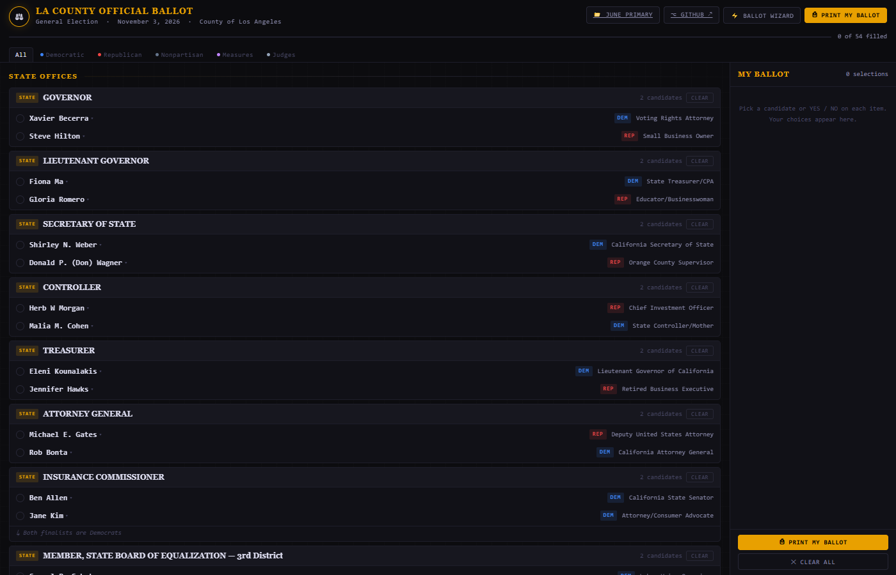
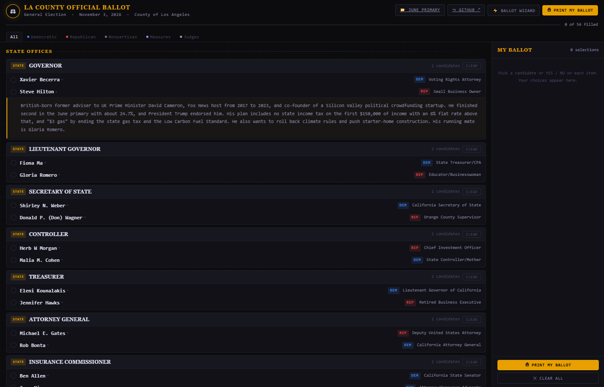
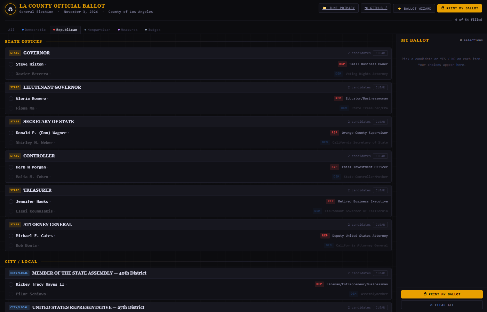
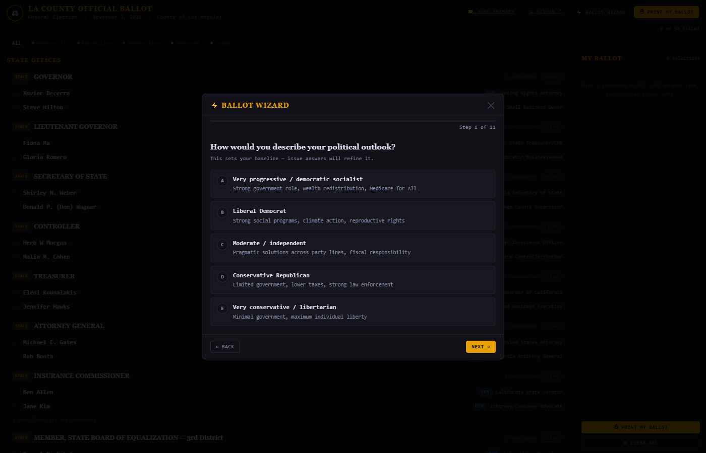
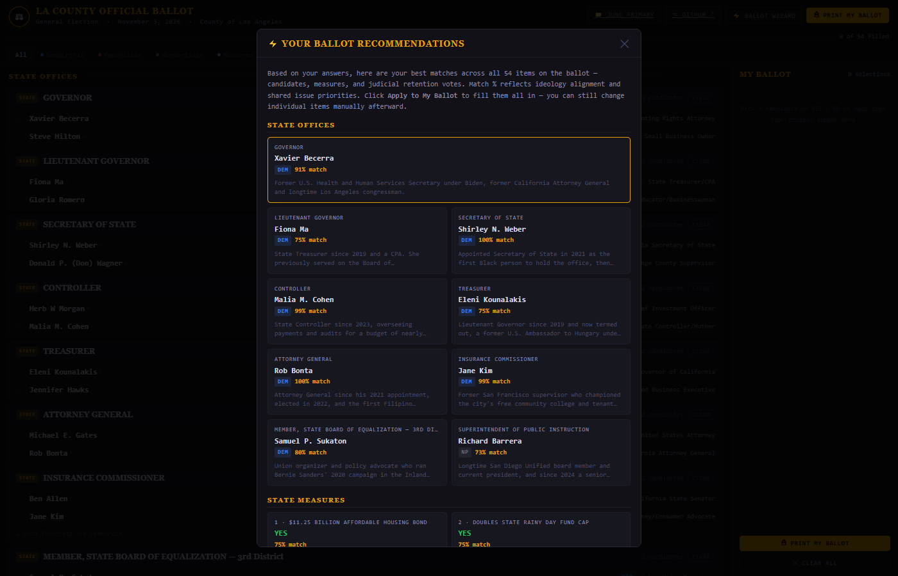
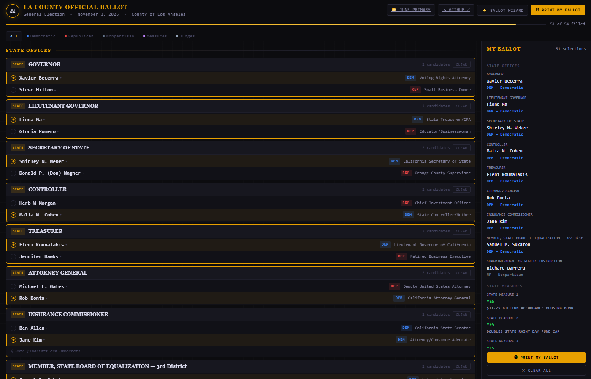
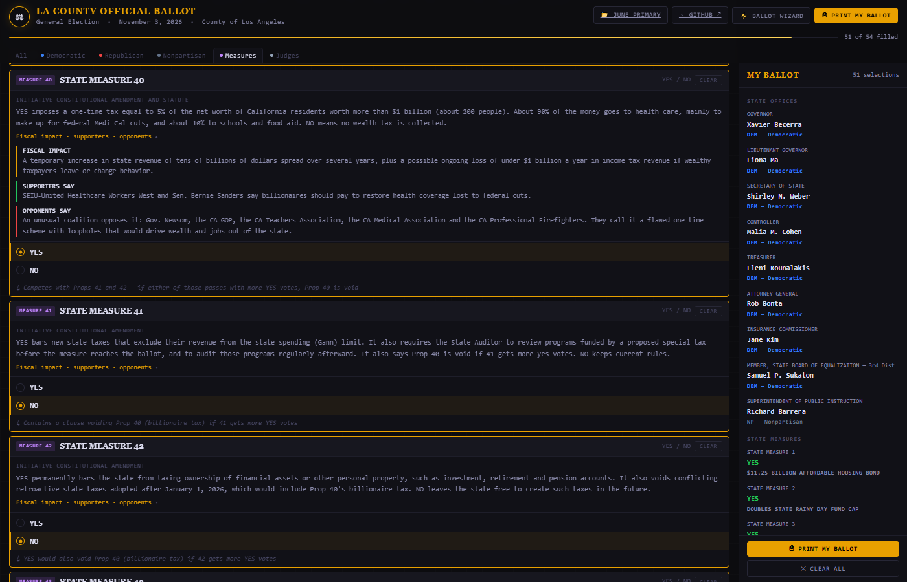

# LA County Ballot Guide — November 3, 2026 General Election

An interactive voter guide for the **Los Angeles County General Election, November 3, 2026** (Santa Clarita ballot). Built as a single self-contained HTML file with no backend, no dependencies, and no build step — just open it in a browser.

🗳️ **Live site:** [dborges.github.io/la-ballot-guide-2026](https://dborges.github.io/la-ballot-guide-2026/)

📁 **June 2, 2026 Primary guide (archived):** [dborges.github.io/la-ballot-guide-2026/archive/2026-06-primary/](https://dborges.github.io/la-ballot-guide-2026/archive/2026-06-primary/) — source in [`archive/2026-06-primary/`](archive/2026-06-primary/)

---

## What's Inside

**54 ballot items** — 18 candidate races (37 candidates), 16 measures, and 20 judicial retention votes:

| Section | Items |
|---|---|
| State Offices | Governor, Lt. Governor, Secretary of State, Controller, Treasurer, Attorney General, Insurance Commissioner, Board of Equalization (3rd District), Superintendent of Public Instruction |
| State Measures | Props 1, 2, 3, 4, 5, 37, 38, 39, 40, 41, 42, 43, 44, 45 |
| City / Local | Santa Clarita City Council (4th District), Saugus Union School District (Trustee Area 5), State Assembly 40th District, U.S. Representative 27th District |
| County | Sheriff, County Measure A (binding arbitration), County Measure E (Ethics Commission / Measure J funding) |
| Superior Court | Offices 64, 65, 87, 131 |
| Retention | 2 Supreme Court justices + 18 Court of Appeal (2nd District) justices |

---

## Features

### ⚡ Ballot Wizard
Answer 11 questions about your values and policy positions — housing, climate, public safety, fiscal policy, education, healthcare, immigration, elections & ethics, judge background, and incumbent preference. The wizard recommends a candidate in every race and **YES or NO on every measure and retention vote**. Click **Apply to My Ballot** to fill everything in at once. Measures that come out as a genuine toss-up for your answers are flagged and left blank for you to decide.

### 📜 Measure Details
Every measure card shows a plain-English summary of what YES and NO do, plus an expandable panel with the LAO fiscal impact and what supporters and opponents say. Competing measures (Props 40, 41, 42) and counterintuitive ones (Prop 43) carry a warning note.

### 📖 Candidate & Justice Bios
Click any candidate's or justice's name to expand a researched biography — career, June primary result, endorsements, and controversies.

### 🎛️ Filters
Filter by party (Democratic, Republican, Nonpartisan), or show only **Measures** or only **Judges**.

### 🗂️ My Ballot Sidebar
A sticky sidebar tracks your selections, grouped by section, with a live progress bar (X of 54 filled). On phones it's a slide-up drawer.

### ⎙ Print
The print stylesheet renders only your selections — a cheat sheet to bring to the polling place. If anything is still blank (for example, wizard toss-ups), a pre-print check lists the unfilled items so you can jump to them or print anyway.

---

## Ballot Photos

The `ballot-page-*.jpg` images are photos of the actual official ballot:

| File | Contents |
|---|---|
| `ballot-page-1-santa-clarita-saugus-assembly-usrep-sheriff-judges.jpg` | Page 1 — Santa Clarita Council D4, Saugus USD Area 5, Assembly 40th, US Rep 27th, Sheriff, Superior Court 64/65/87 |
| `ballot-page-2-judge-131-county-measures-state-offices.jpg` | Page 2 — Superior Court 131, County Measures A & E, Governor through Insurance Commissioner |
| `ballot-page-3-boe-superintendent-state-measures-1-5.jpg` | Page 3 — Board of Equalization, Superintendent, Props 1–5 |
| `ballot-page-4-state-measures-37-41.jpg` | Page 4 — Props 37–41 |
| `ballot-page-5-state-measures-42-45-supreme-court.jpg` | Page 5 — Props 42–45, Supreme Court, Court of Appeal Presiding Justices Div. 3 & 4 |
| `ballot-page-6-court-of-appeal.jpg` | Page 6 — Court of Appeal (Divs. 1–7) |
| `ballot-page-7-court-of-appeal-end-of-ballot.jpg` | Page 7 — Court of Appeal (Divs. 6–8), End of Ballot |

---

## How It Works

Everything runs client-side in a single HTML file:

- **Data** — `BALLOT` holds all 54 items. Candidate races list candidates (name, party, ballot designation, bio); measures (`kind:'measure'`) carry a summary, fiscal impact, and pro/con; retention votes (`kind:'retain'`) carry the justice's bio
- **Candidate scoring** — `SCORES` assigns each candidate an ideology score (1.0 = far left → 5.0 = far right), up to 3 issue tags, an incumbent flag, and a judicial background type; `wzScoreCand()` weighs 60% ideology closeness + 40% issue-tag overlap + incumbent bonus/penalty
- **Measure scoring** — each measure has a `lean` (where a typical YES voter sits) and a topic; `wzScoreMeasure()` compares your answer on that topic to the YES and NO positions
- **Retention scoring** — no Court of Appeal justice has ever lost a retention vote (the only losses were three Supreme Court justices in 1986) and none of this year's justices face organized opposition, so YES is the baseline; your judge-background and incumbent preferences adjust the match %
- **No frameworks** — pure HTML, CSS, and vanilla JavaScript; no build step, no external CDN

---

## Notes on This Ballot

- **Props 40, 41, 42 conflict** — 41 and 42 each void the Prop 40 billionaire tax if they get more YES votes
- **Prop 43** — YES raises the threshold for citizen-proposed local special taxes to two-thirds
- **Measure A, Props 38 and 44** — supported or opposed by unusual cross-party coalitions, so the wizard treats them as toss-ups
- **Two all-Democrat races** — Insurance Commissioner (Allen vs. Kim) and Board of Equalization (Gipson vs. Sukaton)

---

## Screenshots

| | |
|---|---|
|  |  |
| **Main ballot guide** — all 54 items with party badges | **Candidate bio** — click any name to expand a researched biography |
|  |  |
| **Party filter** — Republican selected | **⚡ Ballot Wizard** — 11 questions about your values and policy positions |
|  |  |
| **Wizard results** — candidate and YES/NO recommendations with match % | **Ballot filled** — recommendations applied to the My Ballot sidebar |
|  | |
| **Measure details** — summary, fiscal impact, supporters & opponents | |

---

## Running Locally

No build required. Just open the file:

```bash
open index.html          # macOS
start index.html         # Windows
xdg-open index.html      # Linux
```

Or serve it with any static file server:

```bash
npx serve .
python -m http.server 8080
```

---

## Data Sources

- [California Secretary of State Official Voter Guide](https://voterguide.sos.ca.gov/) and [Legislative Analyst's Office](https://lao.ca.gov/BallotAnalysis/Propositions) (measures)
- [CalMatters 2026 Voter Guide](https://calmatters.org/california-voter-guide-2026/)
- [LAist Voter Guides](https://laist.com/news/politics/voter-guides)
- [The Signal](https://signalscv.com) and [KHTS](https://www.hometownstation.com) (Santa Clarita races)
- [LA County Bar Association JEEC ratings](https://www.lacba.org) (Superior Court)
- [California Courts](https://appellate.courts.ca.gov) and Governor's appointment announcements (retention justices)
- [Ballotpedia](https://ballotpedia.org), Wikipedia, and candidate campaign websites

---

## License

Public domain — do whatever you want with it.
